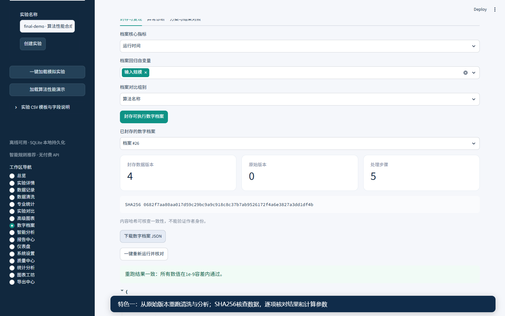
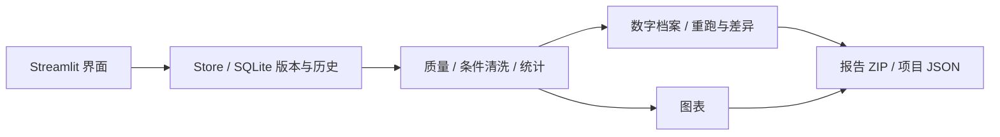

# 数迹实验数据工坊 · LabLedger 2.1

面向大学生实验课程与科研入门的个人本地实验数字档案工具。把散落的数据、清洗步骤、分析参数和报告连在一起，让结果可以重跑核对。唯一正式仓库：[yumingye/LabLedger](https://github.com/yumingye/LabLedger)。发布验收状态以[本轮验收报告](docs/FINAL_ACCEPTANCE_REPORT.md)为准。

## 功能与创新

- 实验与数据表管理、CSV 导入、录入修改删除、搜索筛选、质量检查，SQLite 持久化和乐观锁防止旧窗口覆盖。
- 清洗先预览再保存版本，支持按实验条件填补和检测异常；原始版本保留，恢复产生新版本。
- 描述统计、相关、回归、组间比较、12 类高级图表和 PNG/SVG/离线 HTML 导出；编辑结论并生成完整报告 ZIP。
- **可执行数字档案**：保存输入版本、清洗链与分析参数，SHA256 校验后实际重算，展示数值差异（容差 1e-9）。哈希不能证明测量真实或作者身份。
- **条件异常诊断**：按算法、规模等条件列出位置、界限和建议，异常候选不等于实验错误。
- **方案与结果对照**：目标、均值偏差和 t 置信区间并列；描述性达标不等于等效性或因果证明。

## 演示与截图

[最终浏览器演示 MP4：211.32 秒](demo/recordings/LabLedger_Competition_Final_Demo.mp4)，中文字幕、无配音，真实浏览器操作。GitHub 文件页如不提供内嵌播放，点击 Raw/Download 下载后播放。不要以历史快速验收录像代替这段正式演示。



演示使用固定随机种子的合成数据，**不代表真实测量或算法性能结论**。三种 CSV 示例及字段说明位于 [demo/templates](demo/templates)。不需要模型、API Key 或外部数据集。

## 技术栈与架构

Python 3.12、Streamlit、SQLite、Pandas/NumPy/SciPy、Plotly/Matplotlib；Pytest/AppTest 和 Playwright 用于验证。



[最终架构与数据流](docs/FINAL_ARCHITECTURE.md) · [数据库设计与迁移](docs/ARCHITECTURE.md) · [开发文档](docs/DEVELOPMENT.md)。首次运行自动建库和兼容迁移，无需外部数据库服务或预置数据库文件。

## 安装与启动

已验证平台：Windows，Python 3.12（含 venv），建议至少 4GB 可用内存。安装 Git 和 Python，确保 `python --version` 为 3.12。首次安装需要网络。用 PowerShell 将仓库 Clone 到 D 盘的任意可写目录；以下相对命令不依赖原开发机路径。

```powershell
git clone https://github.com/yumingye/LabLedger.git
cd LabLedger
powershell -ExecutionPolicy Bypass -File .\install.ps1
powershell -ExecutionPolicy Bypass -File .\start.ps1
```

打开 [本地界面](http://127.0.0.1:8501)，保持终端运行；Ctrl+C 停止。再次启动会恢复已保存实验。安装脚本创建本仓库独立 `.venv`，按 `requirements-lock.txt` 安装并执行 `pip check`；锁文件同时包含测试依赖。首次安装失败应检查网络及错误日志，不建议跳过依赖检查。离线使用须自行预备完整锁定版本 wheel 集合，通过 `LABLEDGER_WHEELHOUSE` 指定；仓库不携带依赖包或虚拟环境。

产品安装后可以离线使用。所有受控缓存、临时目录、数据和配置均在项目内，按任务约束应将项目放 D 盘。系统字体和浏览器从已有安装读取；浏览器手动下载目录请设为本仓库 exports。未验证其他操作系统，不作跨平台验收承诺。

## 十分钟体验

1. 点击“加载算法性能演示”，或创建实验、字段并在“数据记录”上传 CSV。每次加载生成独立实验。
2. “实验详情”填写目标和条件；“数据清洗”预览去重、条件填补与异常标记，保存生成版本。
3. “专业统计”保存分析快照；“实验对比”固定输入规模，查看组间差异；“高级图表”导出图表。
4. “数字档案”封存并一键重新运行核对，在同页查看异常诊断、方案与结果对照。
5. “智能分析”编辑保存结论；“报告中心”生成并下载 ZIP，含 HTML、Markdown、CSV、PNG 与项目 JSON。修改数据或结论后重新生成。
6. “系统设置”导出完整项目 JSON、创建 SQLite 备份或确认恢复；重启后检查原实验。删除需确认，恢复前自动保留当前库副本。

详见[使用教程及异常处理](docs/USER_GUIDE.md)。个人数据在 `data/`，下载报告和备份在 `exports/`；它们不进入公开仓库。不要删除个人数据目录来解决启动问题。

## 实际测试与复现

2026-11-13，本轮完整测试 **114 passed，0 failed**（17.56 秒），原测试预期未改；[原始输出](reports/final-release-20261113/tests-rerun.txt)及[JUnit](reports/final-release-20261113/tests-rerun.xml)。首次受限环境停滞记录保留，本轮通过结果来自允许本机回环通信的运行。测试覆盖 CRUD、持久化、异常输入、统计参考值、档案重跑、图表导出及界面交互。

```powershell
powershell -ExecutionPolicy Bypass -File .\test.ps1
```

完整真实浏览器复验额外需要 FFmpeg 和 Playwright Chromium；它们不是产品启动依赖。安装脚本完成后，在独立验证副本中执行以下命令。浏览器也下载到该副本的 D 盘目录，不依赖开发缓存。

```powershell
. .\scripts\env.ps1
.\.venv\Scripts\python.exe -m playwright install chromium
.\.venv\Scripts\python.exe scripts/verify_final_release.py
```

脚本使用独立 `data/deployment.sqlite3` 和端口 8517/8503，执行测试、真实业务操作和重启。仅在独立验证副本中运行，避免改动日常工作数据和已有验收输出。录像的旧脚本默认系统 Edge；可用 `LABLEDGER_BROWSER_EXECUTABLE` 指定浏览器，空字符串表示 Playwright Chromium。独立验证精确证据见[最终验收](docs/FINAL_ACCEPTANCE_REPORT.md)。历史 V1/V2 和三轮报告保留用于追溯，不代替本次远程 Clone 验收。

## 目录与评审材料

| 路径 | 内容 |
|---|---|
| app.py、labledger/ | 完整界面、数据层、统计、图表和档案源码 |
| tests/、scripts/ | 自动化测试、环境与验证脚本 |
| requirements*.txt、install/start/test.ps1 | 依赖与操作入口 |
| docs/ | 开发、架构、数据库、使用、AI、授权、最终审计与验收 |
| demo/ | 合成示例及正式 MP4 |
| reports/、final_optimization/reports/ | 真实测试结果、三轮记录与截图 |

[最终文件清单](docs/FINAL_REPOSITORY_MANIFEST.md) · [SHA256 清单](docs/FINAL_RELEASE_SHA256.txt) · [本轮审计](docs/FINAL_RELEASE_AUDIT.md)。SHA256 清单排除自身，验收增补后需重新生成；不是数字签名。

## 授权、第三方资源与 AI

原创作品保留全部著作权，向赛事主办方和评审人员授予仅用于竞赛评审、验收的非独占、非商业访问、下载、复制和运行许可，不授予其他商业使用或再分发权。详见[源码授权](LICENSE_NOTICE.md)。第三方组件适用各自许可证，见[第三方来源与许可](docs/THIRD_PARTY_NOTICES.md)、[完整依赖许可](reports/licenses.json)、[SciPy 许可](docs/SCIPY_LICENSE.txt)。没有分发浏览器、字体、FFmpeg 或依赖二进制。

Codex 实际参与设计、实现、测试与文档；运行时只有本地可解释统计规则，没有大模型调用或模型训练。AI 工作不计为人工独立编写，详见[最终 AI 声明](docs/FINAL_AI_USAGE.md)。个人参赛，唯一参赛者 yumingye，已知贡献及排名见[团队分工](docs/TEAM_CONTRIBUTIONS.md)。真实身份和赛事资格通过赛事渠道核验，不公开私人联系方式。

依明确隐私授权，公开 Git 历史从干净发布快照开始，原始开发历史完整保留在本地 Bundle，不重写原仓库；见[隐私审计](docs/PUBLIC_HISTORY_PRIVACY_AUDIT.md)。

## 局限性

定位本地单用户；没有身份权限、云同步、海量数据或多浏览器矩阵保证。完整版本快照会增加磁盘使用。多重比较未校正，统计假设需要实验设计支持；没有真实用户研究。部分旧图表快照仅展示 JSON 配置；PDF/Ollama 未集成。不以功能测试代替赛事 AI、原创性与资格审核。版本演进见[2.1 发布说明](docs/FINAL_RELEASE_NOTES.md)。
